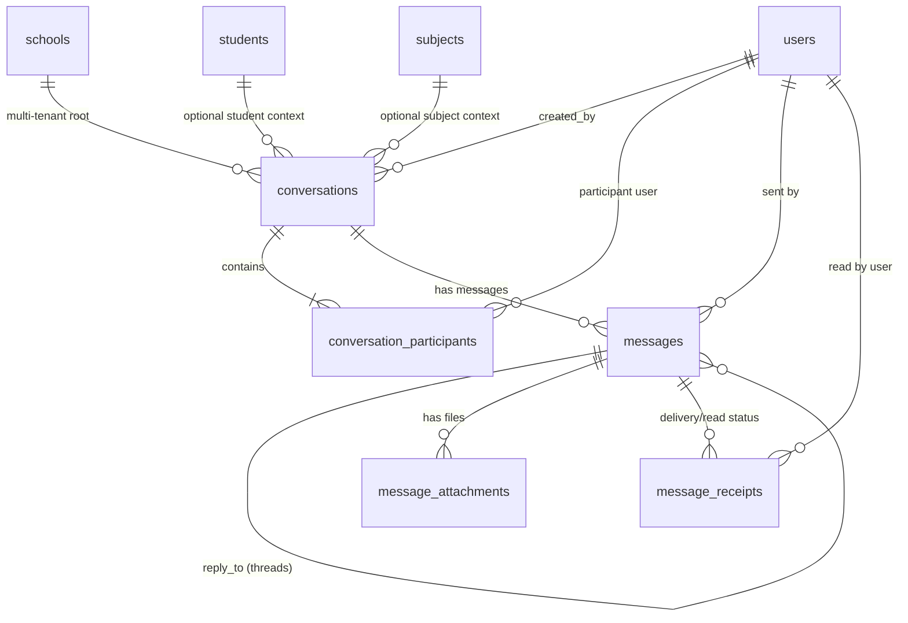

# SMART SMS: Messaging & Communication Hub Specification & Implementation Guide
**Module:** Direct Stakeholder Messaging Suite (Parent-Teacher & Institutional Dialogue)  
**Target Environment:** Multi-Tenant School Management SaaS (SMART SMS)  
**Version:** 1.0.0-PROD  
**Status:** Engineering Ready  

---

## 1. Executive Summary & Purpose

The **Messaging Module** is the direct conversational engine of the SMART SMS platform. While the **Announcements** module handles 1-to-many broadcast bulletins (circulars, calendar updates, emergencies) and the **Notifications** module handles automated event triggers (attendance alerts, fee invoice receipts, published grades), the **Messaging Module** delivers structured, threaded, and audit-compliant **two-way communication** between key school stakeholders:

1. **Parents $\leftrightarrow$ Class / Homeroom Teachers**: Discuss student behavioral notes, absence excuses, pastoral care, and overall development.
2. **Parents $\leftrightarrow$ Subject Teachers**: Academic performance consultations, homework guidance, subject-specific remediation.
3. **Parents $\leftrightarrow$ School Administration / Office**: Official administrative inquiries (admissions, tuition fee plans, transportation logistics, clinic health notices).
4. **Teachers $\leftrightarrow$ School Administrators & Staff**: Internal departmental coordination, schedule changes, school event planning.
5. **Teachers $\leftrightarrow$ Students**: Supervised academic guidance and assignment assistance within school boundaries.

```
+==================================================================================================+
|                                  SMART SMS COMMUNICATION TRIAD                                   |
+==================================================================================================+
|                                                                                                  |
|   +--------------------------+  +--------------------------+  +-------------------------------+  |
|   |    1. Announcements      |  |    2. Notifications      |  |     3. Messaging (This Doc)   |  |
|   |  - 1-to-many broadcast   |  |  - Automated triggers    |  |  - 2-way threaded dialog     |  |
|   |  - School-wide / Grade   |  |  - Attendance absent     |  |  - Parent <-> Teacher        |  |
|   |  - Acknowledgment audits |  |  - Fee invoices & pays   |  |  - Parent <-> Admin / Office |  |
|   |  - Pinned circulars      |  |  - Exam results release  |  |  - Contextual student pills  |  |
|   +--------------------------+  +--------------------------+  +-------------------------------+  |
|                                                                                                  |
+==================================================================================================+
```

---

## 2. Core Functional Requirements & Educational Governance

Educational institutions require strict boundaries around direct messaging to protect children, prevent harassment, ensure privacy compliance, and eliminate unstructured spam.

### 2.1 Authorized Contact Discovery (Strict RBAC Boundary)
Users cannot initiate conversations with arbitrary accounts across the platform. The contact directory is strictly generated based on active school enrollments:

| User Role | Permitted Conversation Partners |
| :--- | :--- |
| **Parent** | - Homeroom / Class Teachers of their linked active children.<br>- Subject Teachers actively teaching their children in the current academic year.<br>- School Administrators and official Office Staff.<br>*(Cannot message other parents, unrelated students, or unrelated teachers).* |
| **Teacher** | - Parents of students in their assigned homeroom sections or enrolled subject classes.<br>- School Administrators, Department Heads, and fellow Staff members.<br>- Students enrolled in their active classes (if student chat is enabled). |
| **Student** | - Their assigned Homeroom Teacher and active Subject Teachers.<br>*(Cannot message other students directly to prevent unsupervised peer harassment).* |
| **School Admin** | - Any registered staff, teacher, student, or parent within their multi-tenant school (`school_id`). |

### 2.2 Student Context Binding
A core feature of SMART SMS is that parent-teacher conversations are optionally **bound to a specific student context** (`student_id`). When a teacher receives an inquiry from a parent with multiple children, the conversation header immediately highlights:
- Student Name, Roll Number, and Photo
- Grade & Section (e.g., Grade 9-B)
- Linked Academic Subject (e.g., Mathematics)
- Quick links to the student's recent attendance rate and grade book

### 2.3 Safeguarding & Audit Compliance
- **Soft Deletes Only**: Messages deleted by users are flagged with `deleted_at` and hidden from the chat interface, but the record is permanently retained in the database for legal safeguarding and administrative audit disputes.
- **Administrative Dispute Review**: School Admins have compliance rights to inspect conversation threads flagged for misconduct, bullying, or grading disputes.
- **Read Receipts & Delivery Timestamps**: Clear visual indicators for `SENT`, `DELIVERED`, and `READ` status.

---

## 3. Database Schema & Migration Specification

The module is powered by 4 interconnected relational tables in PostgreSQL 17 using `node-pg-migrate`:



### 3.1 Table: `conversations`
Represents the parent container for a thread between two or more participants.

| Column | Type | Constraints / Defaults | Description |
| :--- | :--- | :--- | :--- |
| `id` | UUID | PRIMARY KEY, `gen_random_uuid()` | Unique thread identifier. |
| `school_id` | UUID | NOT NULL, REFERENCES `schools(id)` ON DELETE CASCADE | Multi-tenant tenant boundary. |
| `type` | VARCHAR(30) | NOT NULL, DEFAULT `'DIRECT'` | `'DIRECT'` (1-to-1), `'ACADEMIC_INQUIRY'`, `'OFFICE_SUPPORT'`, `'GROUP_SECTION'`. |
| `title` | VARCHAR(255) | NULLABLE | Optional subject or inquiry topic. |
| `student_id` | UUID | REFERENCES `students(id)` ON DELETE SET NULL | Context student for parent-teacher inquiries. |
| `subject_id` | UUID | REFERENCES `subjects(id)` ON DELETE SET NULL | Context subject for course-related inquiries. |
| `created_by` | UUID | NOT NULL, REFERENCES `users(id)` ON DELETE CASCADE | User who initiated the thread. |
| `last_message_at` | TIMESTAMPTZ | NOT NULL, DEFAULT `CURRENT_TIMESTAMP` | Denormalized timestamp for sorting active inbox. |
| `last_message_preview` | TEXT | NULLABLE | Snippet of the latest message for fast inbox rendering. |
| `status` | VARCHAR(20) | NOT NULL, DEFAULT `'ACTIVE'` | `'ACTIVE'`, `'RESOLVED'`, `'ARCHIVED'`. |
| `created_at` | TIMESTAMPTZ | NOT NULL, DEFAULT `CURRENT_TIMESTAMP` | Creation audit time. |
| `updated_at` | TIMESTAMPTZ | NOT NULL, DEFAULT `CURRENT_TIMESTAMP` | Last modification time. |
| `deleted_at` | TIMESTAMPTZ | NULLABLE | Soft delete timestamp. |

### 3.2 Table: `conversation_participants`
Tracks participant state, unread badges, mute settings, and archive states per user.

| Column | Type | Constraints / Defaults | Description |
| :--- | :--- | :--- | :--- |
| `id` | UUID | PRIMARY KEY, `gen_random_uuid()` | Unique participant record identifier. |
| `conversation_id` | UUID | NOT NULL, REFERENCES `conversations(id)` ON DELETE CASCADE | Target thread. |
| `user_id` | UUID | NOT NULL, REFERENCES `users(id)` ON DELETE CASCADE | Enrolled user. |
| `role_in_conversation` | VARCHAR(30) | NOT NULL, DEFAULT `'PARTICIPANT'` | `'INITIATOR'`, `'PARTICIPANT'`, `'MODERATOR'`. |
| `last_read_at` | TIMESTAMPTZ | NOT NULL, DEFAULT `CURRENT_TIMESTAMP` | Timestamp up to which the user has read messages. |
| `unread_count` | INTEGER | NOT NULL, DEFAULT `0` | Cached unread count for fast sidebar badge rendering. |
| `is_muted` | BOOLEAN | NOT NULL, DEFAULT `false` | Whether notifications are silenced. |
| `is_archived` | BOOLEAN | NOT NULL, DEFAULT `false` | Whether thread is moved to user's archive folder. |
| `is_starred` | BOOLEAN | NOT NULL, DEFAULT `false` | Pinned or favorite thread. |
| `joined_at` | TIMESTAMPTZ | NOT NULL, DEFAULT `CURRENT_TIMESTAMP` | Date user was added. |

*Constraint:* `UNIQUE (conversation_id, user_id)`

### 3.3 Table: `messages`
The individual messages exchanged within a conversation.

| Column | Type | Constraints / Defaults | Description |
| :--- | :--- | :--- | :--- |
| `id` | UUID | PRIMARY KEY, `gen_random_uuid()` | Unique message identifier. |
| `conversation_id` | UUID | NOT NULL, REFERENCES `conversations(id)` ON DELETE CASCADE | Parent conversation. |
| `sender_id` | UUID | NOT NULL, REFERENCES `users(id)` ON DELETE CASCADE | Author of the message. |
| `message_type` | VARCHAR(30) | NOT NULL, DEFAULT `'TEXT'` | `'TEXT'`, `'ATTACHMENT'`, `'SYSTEM_EVENT'`. |
| `content` | TEXT | NOT NULL | Body of the message (supports markdown & emojis). |
| `reply_to_message_id` | UUID | REFERENCES `messages(id)` ON DELETE SET NULL | Parent message if this is a quote/reply. |
| `is_edited` | BOOLEAN | NOT NULL, DEFAULT `false` | Flag if edited by sender. |
| `edited_at` | TIMESTAMPTZ | NULLABLE | Timestamp of edit. |
| `created_at` | TIMESTAMPTZ | NOT NULL, DEFAULT `CURRENT_TIMESTAMP` | Dispatch timestamp. |
| `deleted_at` | TIMESTAMPTZ | NULLABLE | Safeguarding soft-delete flag. |

### 3.4 Table: `message_attachments`
Uploaded files (PDF excuse notes, medical slips, homework homework images).

| Column | Type | Constraints / Defaults | Description |
| :--- | :--- | :--- | :--- |
| `id` | UUID | PRIMARY KEY, `gen_random_uuid()` | Attachment identifier. |
| `message_id` | UUID | NOT NULL, REFERENCES `messages(id)` ON DELETE CASCADE | Associated message. |
| `file_name` | VARCHAR(255) | NOT NULL | Original upload filename. |
| `file_url` | TEXT | NOT NULL | Stored URL or path. |
| `file_type` | VARCHAR(100) | NOT NULL | MIME type (`image/png`, `application/pdf`, etc.). |
| `file_size` | INTEGER | NOT NULL | Size in bytes (max 10MB). |
| `created_at` | TIMESTAMPTZ | NOT NULL, DEFAULT `CURRENT_TIMESTAMP` | Upload time. |

### 3.5 High-Performance Composite Indexes
```sql
CREATE INDEX idx_conversations_inbox ON conversations(school_id, last_message_at DESC) WHERE deleted_at IS NULL;
CREATE INDEX idx_participants_user_inbox ON conversation_participants(user_id, is_archived, unread_count);
CREATE INDEX idx_messages_chronological ON messages(conversation_id, created_at ASC) WHERE deleted_at IS NULL;
CREATE INDEX idx_messages_sender ON messages(sender_id);
CREATE INDEX idx_attachments_message ON message_attachments(message_id);
```

---

## 4. Backend Architecture & Service Layer Breakdown

The backend adheres strictly to the modular layered architecture of SMART SMS:
`backend/src/modules/messages/`

```
backend/src/modules/messages/
├── message.routes.js          # Express route definitions & RBAC guards
├── message.controller.js      # HTTP request handling & JSON response enveloper
├── message.service.js         # Business logic, authorization rules, notification triggers
├── message.repository.js      # Raw SQL queries, connection pool transactions
└── message.validation.js      # Request body & query sanitization schemas
```

### 4.1 Repository Layer (`message.repository.js`)
- `getUserConversations(schoolId, userId, filters)`: Retrieves all conversation threads for a user with participant avatars, names, roles, student context pill, unread count, and last message snippet.
- `findDirectConversation(schoolId, userOneId, userTwoId, studentId)`: Determines if an identical direct conversation already exists between two users (optionally regarding the same child) to prevent duplicate threads.
- `createConversationTransaction(conversationData, participantUserIds)`: Runs inside an ACID transaction (`BEGIN` / `COMMIT`) to insert the conversation and all participant rows atomically.
- `getConversationMessages(conversationId, options)`: Returns paginated messages ordered chronologically, joining sender names, sender avatars, attached files, and quoted replies.
- `createMessage(messageData, attachments)`: Inserts message, batch-inserts attachments, updates `conversations.last_message_at` and `last_message_preview`, and increments `unread_count` for all *other* participants.
- `markConversationAsRead(conversationId, userId)`: Sets `unread_count = 0` and updates `last_read_at = CURRENT_TIMESTAMP`.
- `getEligibleContacts(schoolId, user)`: Dynamic relational query mapping who the requesting user is allowed to message based on enrolled children, assigned classes, and staff roles.

### 4.2 Service Layer (`message.service.js`)
- **Permission & Security Checks**:
  - Verifies that sender has access to `conversationId` (must be an active participant or a School Admin).
  - Validates recipient eligibility using `getEligibleContacts` before initiating a new conversation.
- **Notification Integration**:
  - Automatically dispatches an in-app notification via the existing `notifications` module to the recipient:
    `"New message from [Teacher/Parent Name] regarding [Student Name]"`
- **Global Unread Counter**:
  - Calculates total unread messages across all active conversations for the top navigation bar badge.

### 4.3 REST API Endpoints Specification

| Method | Endpoint | Access | Purpose |
| :--- | :--- | :--- | :--- |
| `GET` | `/api/v1/messages/conversations` | All authenticated | List active conversation inbox with unread counts. |
| `POST` | `/api/v1/messages/conversations` | All authenticated | Start a new conversation or open existing thread. |
| `GET` | `/api/v1/messages/conversations/:id` | Conversation Participants / Admin | Get conversation details and participant list. |
| `GET` | `/api/v1/messages/conversations/:id/messages` | Conversation Participants / Admin | Paginated messages history for the active thread. |
| `POST` | `/api/v1/messages/conversations/:id/messages` | Conversation Participants | Send a new message (text and/or attachments). |
| `PATCH`| `/api/v1/messages/conversations/:id/read` | Conversation Participants | Mark all messages in thread as read. |
| `PATCH`| `/api/v1/messages/conversations/:id/archive` | Conversation Participants | Toggle archive status for current user. |
| `PATCH`| `/api/v1/messages/conversations/:id/mute` | Conversation Participants | Toggle mute notifications for current user. |
| `DELETE`|`/api/v1/messages/:messageId` | Message Author / Admin | Soft delete a message. |
| `GET` | `/api/v1/messages/contacts` | All authenticated | Get list of eligible contacts to initiate message with. |
| `GET` | `/api/v1/messages/unread-count` | All authenticated | Total unread message badge count. |

---

## 5. Frontend UI/UX Architecture & Components

The frontend interface is situated at `/dashboard/messages` and follows a responsive, modern split-pane glassmorphic design system:

```
+---------------------------------------------------------------------------------------------------+
|  SMART SMS Communication Hub > Messages                                 [+ New Message] [Search]  |
+------------------------------------+------------------------------------+-------------------------+
| CONVERSATION INBOX                 | ACTIVE THREAD CONVERSATION         | STUDENT & THREAD INFO   |
| [Search contacts...]               |                                    | (Collapsible Drawer)    |
| [All] [Unread] [Teachers] [Parents]| 👤 Helen Tesfay (Class Teacher 8A) |                         |
|------------------------------------| Child: Dawit Berihu (Grade 8A)     | Student: Dawit Berihu   |
| 🟢 Helen Tesfay (Teacher)    10:42 |                                    | Roll: 8A-14             |
|    Dawit: Math homework help... (2)| ---------------- Today ----------- | Grade: 8 - Section A    |
|                                    | [Parent]: Hello Ms. Helen, Dawit   | Attendance: 96.4%       |
| ⚪ Solomon G. (Admin Office)  Yest | was confused about problem #4.     | Term Average: 88.2%     |
|    Bus route #3 pickup time...     |                               10:40|                         |
|                                    | [Teacher]: Hi Mr. Berihu! He can   | Shared Attachments (2): |
| ⚪ Michael K. (Physics)      Oct 14| refer to textbook page 112.        | 📄 Worksheet_Ch4.pdf    |
|    Mid-term project review...      | 📎 [Worksheet_Ch4.pdf]        10:42| 🖼️ board_notes.jpg     |
|                                    |                                    |                         |
|                                    | +--------------------------------+ | [Mute Notifications]    |
|                                    | | Write a reply...         📎 🚀 | | [Archive Thread]        |
|                                    | +--------------------------------+ |                         |
+------------------------------------+------------------------------------+-------------------------+
```

### 5.1 Key Frontend Components
1. **`MessagesLayout.jsx`**: Responsive flexbox layout container (sidebar list + chat area + context drawer) with mobile drawer toggle.
2. **`ConversationList.jsx`**: Left panel displaying active conversations, search input, filter pills, and live unread badge counters.
3. **`ChatWindow.jsx`**: Center panel managing the scrollable message stream, sticky date dividers, animated chat bubbles, and auto-scroll behavior.
4. **`MessageComposer.jsx`**: Smart textarea with automatic height expansion, emoji shortcut support, file upload button with size validation, and `Enter` to send (`Shift+Enter` for newline).
5. **`NewConversationModal.jsx`**: Accessible modal allowing users to search eligible contacts, select target student context, write an introductory message, and start the thread.
6. **`ContextSidebar.jsx`**: Right-side panel showing the student dossier (attendance %, grade point average, homeroom section) and shared attachment gallery.
7. **`MessageBadge.jsx`**: Component mounted inside `DashboardHeader.jsx` displaying the live unread count with polling/SSE sync.

---

## 6. Implementation Milestones & Roadmap

```mermaid
gantt
    title Messaging Module Implementation Schedule
    dateFormat  X
    axisFormat  Day %d

    section Database
    Migration Script (conversations, messages, attachments, receipts) :0, 1
    Seed Data & Foreign Key Verification                             :1, 1

    section Backend API
    Repository Layer (Queries, Transactions, Scoped Contacts)         :1, 2
    Service & Validation Layer (RBAC, Notifications trigger)          :2, 2
    Controller & Express Routes integration in app.js                 :3, 1
    Integration Tests (RBAC, parent isolation, multi-tenant checks)   :3, 2

    section Frontend UI
    Client Service (messageService.js) & State Management             :4, 1
    Split-pane Layout & Conversation List                             :4, 2
    Chat Stream, Bubbles & Message Composer with Attachments          :5, 2
    New Message Modal with Authorized Contact Directory               :6, 1
    Header Live Unread Badge & Polish                                 :6, 2
```



- **Milestone 1**: Database Migration & Schema Creation (`backend/migrations/1785489200017_create-messaging-tables.js`).
- **Milestone 2**: Backend Layer (`repository`, `service`, `controller`, `validation`, `routes`) mounted at `/api/v1/messages`.
- **Milestone 3**: Authorized Contact Directory Engine (linking parents to their children's teachers and teachers to enrolled parents).
- **Milestone 4**: Frontend Client Service (`src/services/messageService.js`) with complete API integrations.
- **Milestone 5**: Production Frontend Interface at `/dashboard/messages` replacing the placeholder `ModuleComingSoon`.
- **Milestone 6**: Navigation Header Live Unread Counter Badge in `DashboardHeader.jsx`.
- **Milestone 7**: Automated End-to-End Testing (Parent-Teacher exchange test, multi-tenant isolation verification, error handling).

---

## 7. Next Steps & Confirmation

Before executing code changes:
1. **Review this specification** to ensure it aligns with your institution's communication policies.
2. Once confirmed, we will begin with **Step 1 (Database Migration)** and proceed through the milestone schedule together!
